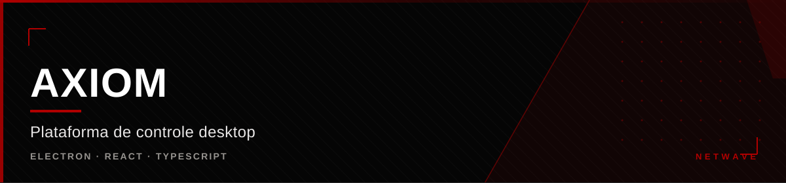

<div align="center">



</div>

<div align="center">

[](https://github.com/hiro0010/axiom) [](https://github.com/hiro0010/axiom) [](https://github.com/hiro0010/axiom) [](https://github.com/hiro0010/axiom)

</div>


## O que é

Axiom é a plataforma de controle da Netwave. Um app desktop que concentra o
gerenciamento do sistema, a interface dos módulos e a identidade do usuário
(Netwave ID) em um só lugar.

Não é um painel com abas: desde 27/set/2026 é **núcleo + módulos instaláveis**,
com instalador enxuto e um wizard que decide o que instalar no primeiro boot.

---

## Arquitetura de módulos

```
AXIOM  = produto principal / núcleo (instalador)
├── Axiom Otimização   → Sistema/PC: Cleaner, Performance, Profiles, Tweaks, Hardware
├── Axiom Social       → Comunicação: Chat, Voz, Chamadas, Servidores, Amigos
└── Axiom Cord         → client mod do Discord (módulo dentro do Social)
```

- **O instalador entrega só o núcleo** — o payload dos módulos é resolvido no wizard.
- A permissão vem da conta (Netwave ID), não do instalador.
- Módulos são **feature flags reais** no main process (services + IPC), não
  rotas ocultas.

### Caminho do usuário

```
Axiom-Install.exe / .flatpak → núcleo instalado → primeiro boot
  → wizard "O que você deseja instalar?" (checkboxes)
  → instala e configura os módulos → Axiom pronto
```

Passos do wizard: boas-vindas e idioma → seleção de módulos (bloqueado sem
entitlement) → permissões (só Otimização) → integrações (só Social: OAuth
Discord, token do bot, RCON Minecraft) → resumo e "Abrir Axiom".

---

## Stack

| Camada | Tecnologia |
|---|---|
| Shell | Electron |
| Interface | React + TypeScript |
| Build | electron-builder |
| Distribuição | NSIS (Windows x64) · Flatpak (Linux / CachyOS) |

Suporte a **Windows** e **Linux** via Flatpak. Telemetria em tempo real
implementada com IPC entre main e renderer.

---

## Diferenciais

- **Monetização por entitlement** — planos e tiers vendidos na Store, com
  expiração ou acesso vitalício
- **Instalador modular** — o usuário instala só o que precisa
- **Netwave ID integrado** — mesma identidade entre site, painel e Minecraft
- **Cross-platform** — mesmo app em Windows e Linux

---

## Status

Desenvolvimento ativo. Build Linux Flatpak funcional. Módulos em
implementação — Otimização é 100% client-side; Social exige backend de
sinalização e mídia.


<div align="center">

<sub>Parte da <a href="https://github.com/hiro0010/netwave">Netwave</a>
&middot; Owner: <a href="https://github.com/hiro0010">Hiro</a></sub>

</div>
